  

  
  
  
  

---

### 👨‍💻 About Me

  

---

### 💼 Experience

  

---

### 🛠️ Tech Stack

<b>Languages</b>

  

<b>Backend & Frontend</b>

  

<b>Cloud, DevOps & Data</b>

  

---

### 📂 Featured Projects

| Project | Description | Tech | Live |
|:--|:--|:--|:--|
| 🌐 [**Developer Portfolio**](https://github.com/aoun02/aoun-portfolio) | Responsive personal portfolio with a code-editor hero, scroll animations and pastel theme | React · Vite · CSS | [aounraza.vercel.app](https://aounraza.vercel.app) |
| 💳 [**PayFlow — Digital Wallet**](https://github.com/aoun02/payflow) | Spring Boot REST API + React dashboard: cards, transfers, charts, filtered history | Java · Spring Boot · JPA · React · Docker | [payflow-aoun.vercel.app](https://payflow-aoun.vercel.app) |
| 🚧 *More coming soon* | .NET 8 MVC application | | |

---

### 📊 GitHub Activity

  
  

  

  <picture>
    <source media="(prefers-color-scheme: dark)" srcset="https://raw.githubusercontent.com/aoun02/aoun02/output/github-snake-dark.svg"/>
    <source media="(prefers-color-scheme: light)" srcset="https://raw.githubusercontent.com/aoun02/aoun02/output/github-snake.svg"/>
    
  </picture>

---

### 📫 Let's Connect

  Reach me on
  <a href="https://www.linkedin.com/in/aoun-raza-5b2638285/">LinkedIn</a> or at <b>aounraza008@gmail.com</b>

